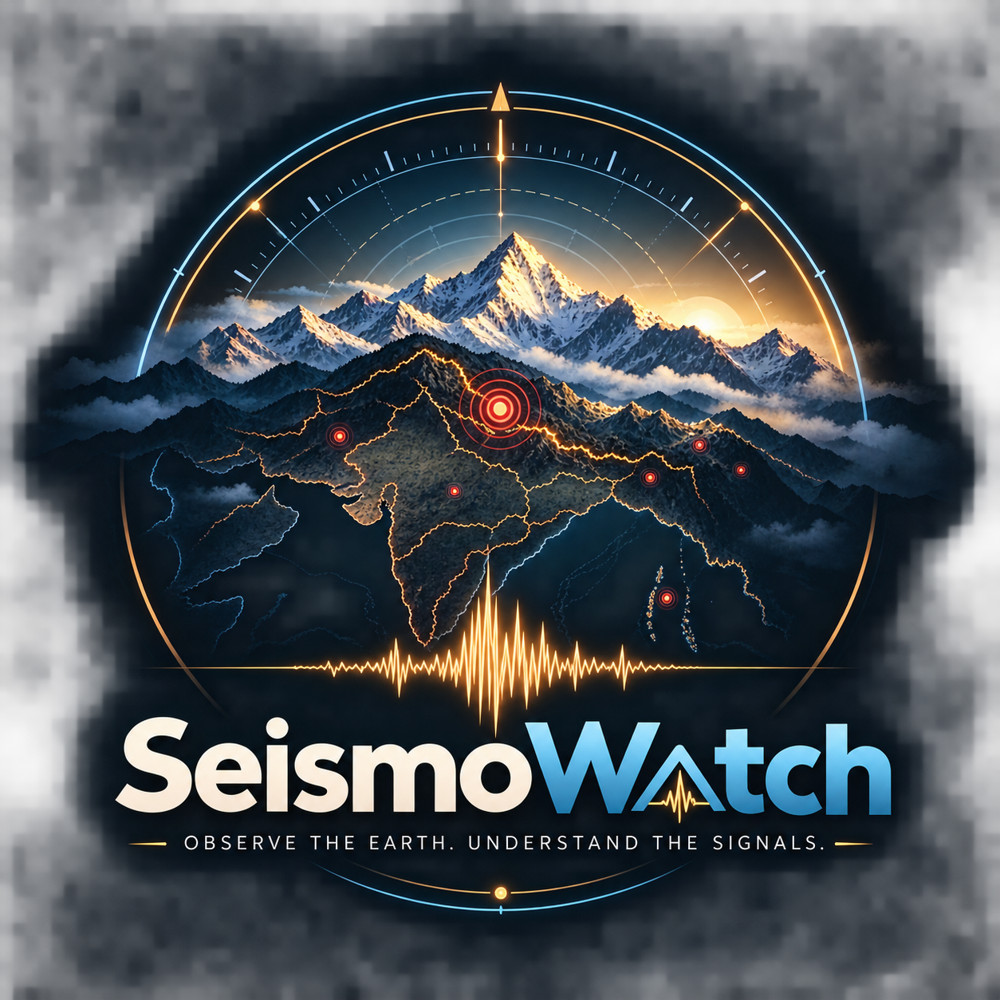
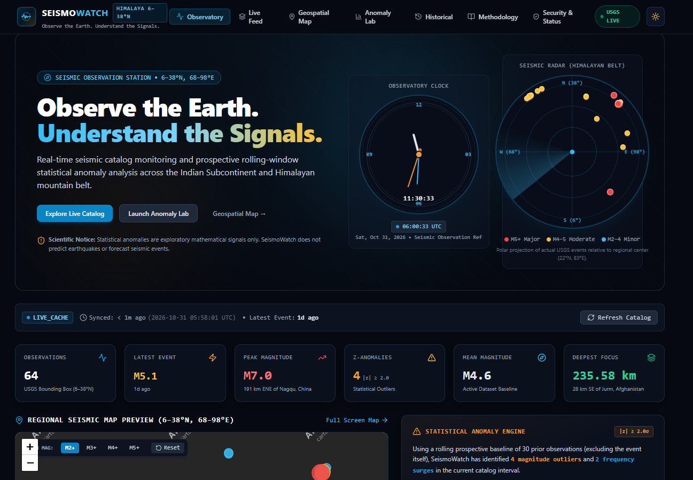
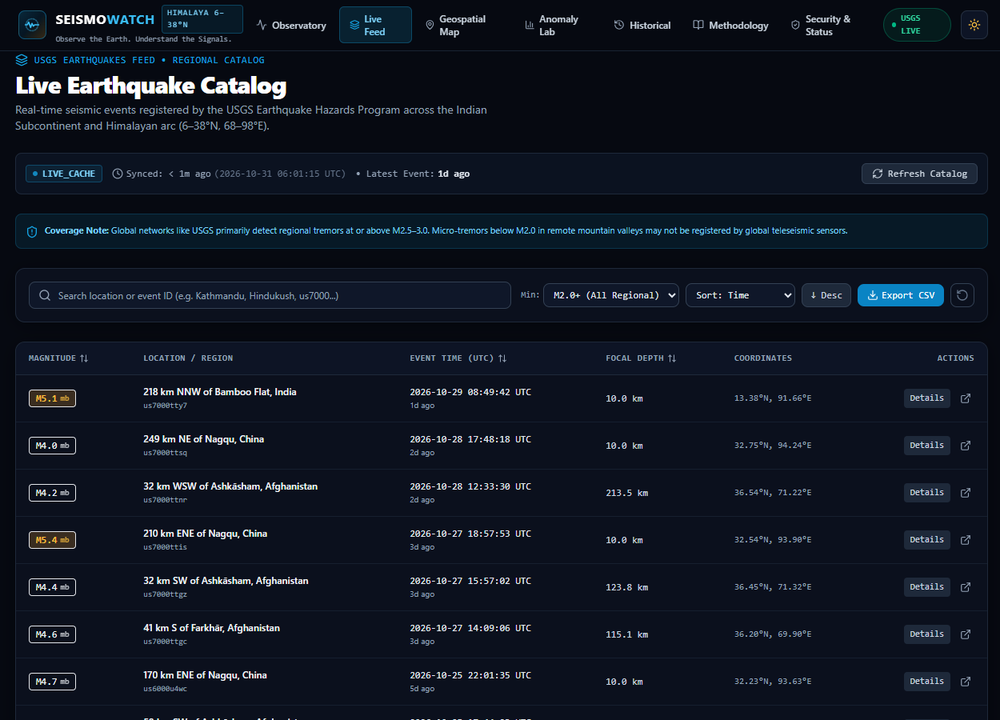
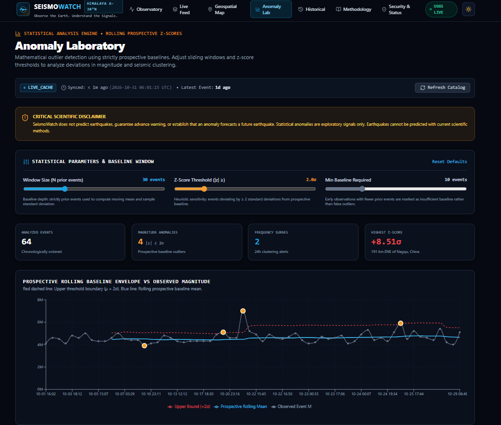
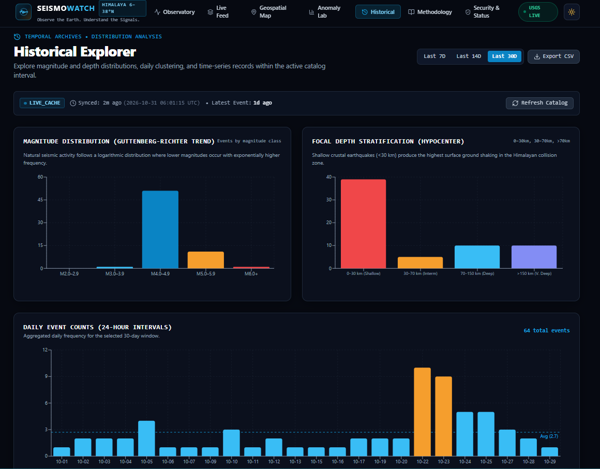

<div align="center">



# SeismoWatch

### Observe the Earth. Understand the Signals.

A real-time earthquake monitoring and statistical anomaly analysis platform
focused on the Indian Subcontinent and Himalayan seismic belt.

[](https://seismowatch-sigma.vercel.app/)

[](https://nextjs.org/)
[](https://www.typescriptlang.org/)
[](https://react.dev/)
[](https://tailwindcss.com/)
[](https://www.postgresql.org/)
[](https://orm.drizzle.team/)
[](https://vercel.com/)
[](https://earthquake.usgs.gov/fdsnws/event/1/)

**[Live Demo](https://seismowatch-sigma.vercel.app/)** · **[Report an Issue](https://github.com/dk-khandelwal06/seismowatch/issues)** · **[Developer](https://www.linkedin.com/in/daksh-khandelwal-b02748391/)** · **[Demo Video]()**

</div>

<br/>

## Overview

SeismoWatch ingests real, live observations from the official **United States Geological Survey (USGS) Earthquake Catalog API**, persists them with **PostgreSQL + Drizzle ORM**, and applies **prospective rolling-window z-score analysis** to surface statistically unusual magnitude and frequency patterns — without making predictive claims.

A raw earthquake catalog tells you *what* happened. It does not tell you whether what just happened is typical for the region or a genuine statistical departure from it. SeismoWatch adds that layer: every observation is compared against the rolling baseline of the events that came strictly *before* it, so the platform can say "this is M4.2, and that's 2.3 standard deviations above what this region has recently produced" — a meaningfully different statement than just logging the number.

The focus region is the **Indian Subcontinent and Himalayan seismic belt** (6°N–38°N, 68°E–98°E), one of the world's most seismically active continental collision zones, where the Indian Plate continues to underthrust the Eurasian Plate.

> ### ⚠️ Scientific Disclaimer
> **SeismoWatch does not predict earthquakes, provide advance early warning, or establish that a statistical anomaly forecasts an imminent rupture.** Earthquakes are non-linear geological phenomena that cannot currently be predicted by any scientific agency or mathematical method. Every anomaly surfaced here is a **retrospective, exploratory statistical signal** — not a forecast. Earthquake catalog completeness also varies by region and sensor density, so absence of an event in this dataset is not evidence of seismic quiet.

<br/>

## The Approach

```
   USGS EARTHQUAKE CATALOG API (GeoJSON)
                  │
                  ▼
   FETCH · VALIDATE
   (bounding-box query, coordinate/timestamp sanitization, deduplication)
                  │
                  ▼
   STORE
   (PostgreSQL + Drizzle ORM — idempotent upserts, ingestion-run audit log)
                  │
                  ▼
   ANALYZE
   (prospective rolling-window z-scores, independent frequency-surge detection)
                  │
                  ▼
   VISUALIZE
   (Observatory dashboard, live catalog, geospatial map, anomaly lab, history)
```

<br/>

## Screenshots

<table>
<tr>
<td width="50%">

**Observatory Dashboard**

Animated Observatory Clock, polar Seismic Radar, and live KPI ribbons for total observations, latest event, peak magnitude, and anomaly counts.

</td>
<td width="50%">

**Live Earthquake Catalog**

Searchable, sortable catalog with magnitude/depth filters, a detail modal per event, and CSV export.

</td>
</tr>
<tr>
<td width="50%">

**Statistical Anomaly Laboratory**

Interactive window size, z-score threshold, and minimum-baseline sliders, with a rolling-baseline chart and flagged-observations register.

</td>
<td width="50%">

**Historical Explorer**

Magnitude and depth distributions over configurable lookback windows, with CSV download.

</td>
</tr>
</table>

<br/>

## Key Features

| Page | Capability |
|---|---|
| **Observatory** (`/`) | Animated Observatory Clock (local + UTC), polar Seismic Radar, live KPI ribbon, map preview, magnitude timeline, 24h frequency histogram |
| **Live Catalog** (`/earthquakes`) | Sortable/searchable table, magnitude & depth filters (M2.0+–M6.0+), per-event detail modal, CSV export |
| **Geospatial Map** (`/map`) | Full-screen Leaflet map (CartoDB Positron / Dark Matter), magnitude-scaled epicenter markers, hover and click detail |
| **Anomaly Laboratory** (`/analytics`) | Configurable window size, z-score threshold, and minimum-baseline sliders; baseline comparison chart; z-score timeline; independent frequency-surge analysis; flagged-observations register |
| **Historical Explorer** (`/history`) | Magnitude distribution and depth-stratification charts over 7/14/30-day windows, with CSV download |
| **Event Detail** (`/earthquakes/[eventId]`) | Deep-dive view of a single event with contextual baseline comparison against surrounding regional activity |
| **Methodology** (`/methodology`) | Documentation of the USGS FDSNWS query parameters, bounding box, and statistical formulas used |
| **Security & Status** (`/security`) | Live `/api/health` diagnostics (gateway, USGS upstream, PostgreSQL), secret-isolation policy, and privacy guarantees |

<br/>

## Statistical Methodology

SeismoWatch's core differentiator is a **prospective rolling-window z-score**, computed server-side in [`src/lib/analytics/engine.ts`](src/lib/analytics/engine.ts).

For each observation $x_i$ in chronological order:

1. **Prospective baseline** — only the prior `windowSize` events are used: $[x_{i-N}, \dots, x_{i-1}]$. The observation never appears in its own baseline, so no event can inflate or deflate the statistic used to judge it.
2. **Rolling mean:** $\mu = \frac{1}{N}\sum_{k=1}^{N} x_k$
3. **Sample standard deviation:** $\sigma = \sqrt{\frac{1}{N-1}\sum_{k=1}^{N}(x_k-\mu)^2}$
4. **Z-score:** $z = \dfrac{x_i - \mu}{\sigma}$

Safety rules enforced in code:
- **Zero-variance guard:** if $\sigma < 0.0001$, $z$ is set to `0` rather than dividing by near-zero.
- **Minimum baseline:** if fewer than `minBaseline` prior events exist (default 10), the event is marked `INSUFFICIENT_BASELINE` and no z-score is computed.
- **Anomaly threshold:** $|z| \ge \text{threshold}$ (default **2.0σ**) flags the event as a statistical outlier.

All three parameters — window size, threshold, and minimum baseline — are adjustable live in the Anomaly Laboratory.

**Frequency anomalies are tracked independently** of magnitude anomalies: daily event counts (UTC calendar days) are bucketed, and a day's count is flagged when its own z-score against the mean/stdDev of all buckets exceeds the threshold — surfacing swarms/clustering that a pure magnitude check would miss.

This is a statistical, exploratory method, not a machine-learning model and not an earthquake-prediction system.

<br/>

## Technology Stack

| Layer | Technology |
|---|---|
| Framework | Next.js 14.2 (App Router, TypeScript) |
| UI | React 18, Tailwind CSS, Lucide React icons |
| Charts | Recharts |
| Maps | Leaflet / React-Leaflet (CartoDB Positron & Dark Matter tiles) |
| Database | PostgreSQL via the `postgres` client |
| ORM / Migrations | Drizzle ORM + Drizzle Kit |
| Testing | Vitest |
| Hosting | Vercel |

<br/>

## Data Source

SeismoWatch queries the official [USGS Earthquake Catalog API (FDSNWS)](https://earthquake.usgs.gov/fdsnws/event/1/) directly — no key required, GeoJSON format, public-domain data. See also the [USGS Earthquake Hazards Program data page](https://earthquake.usgs.gov/data/).

- **Query:** bounding box `minlatitude=6, maxlatitude=38, minlongitude=68, maxlongitude=98`, ordered by time, default `minmagnitude=2.0`, default lookback of 30 days.
- **Sanitization:** coordinates, timestamps, and magnitude are validated before storage; duplicate `eventId`s are resolved to the most recently updated record.
- **Caching:** an in-memory, 3-minute TTL cache sits in front of USGS to stay within fair-use request limits; a stale cache is served if a live fetch fails.
- **Coverage limitation:** the USGS global catalog may have gaps for very small local tremors that only India's National Center for Seismology (NCS) captures regionally — a known, documented limitation rather than a defect.

<br/>

## Getting Started

### Prerequisites
- Node.js 18+ or 20+ LTS
- npm 9+ or 10+
- (Optional) a PostgreSQL database — without one, SeismoWatch still runs and serves live USGS data directly, with persistence reported as `BLOCKED`/unconfigured.

### 1. Clone and install
```bash
git clone https://github.com/dk-khandelwal06/seismowatch.git
cd seismowatch
npm install
```

### 2. Configure environment
```bash
cp .env.example .env.local
```

### 3. Apply database migrations (optional, if `DATABASE_URL` is set)
```bash
npm run db:generate
npm run db:push
```

### 4. Run the test suite
```bash
npm test
```

### 5. Start the dev server
```bash
npm run dev
```
Open [http://localhost:3000](http://localhost:3000).

<br/>

## Environment Variables

| Variable | Required | Description |
|---|---|---|
| `DATABASE_URL` | No | PostgreSQL connection string (Vercel Postgres, Neon, Supabase, or local). If unset, the app serves live USGS data directly and reports persistence as unconfigured rather than failing. |
| `INGESTION_SECRET_TOKEN` | No | Bearer token required to call `POST /api/ingestion/refresh`. If left at its placeholder value or unset, that endpoint is unauthenticated — set a real secret before deploying publicly. |
| `NODE_ENV` | No | Standard Node environment flag. |

Use `.env.example` as the template; never commit `.env.local` or real credentials.

<br/>

## API Endpoints

| Method | Endpoint | Description |
|---|---|---|
| `GET` | `/api/health` | System health: USGS upstream latency, database persistence status, region scope |
| `GET` | `/api/earthquakes` | Paginated, filterable catalog query (magnitude, depth, search, date range, sort) |
| `GET` | `/api/earthquakes/[eventId]` | Single event detail with contextual baseline/z-score comparison |
| `GET` | `/api/analytics/summary` | Aggregate statistics — mean magnitude, anomaly counts, peak frequency interval |
| `GET` | `/api/analytics/timeseries` | Chronological series with rolling baseline and threshold envelope, for charting |
| `GET` | `/api/analytics/anomalies` | Flagged magnitude and frequency anomalies for the given configuration |
| `POST` | `/api/ingestion/refresh` | Triggers a fresh USGS fetch and database upsert; rate-limited to one call per 30 seconds and optionally token-protected |

<br/>

## Deployment

Live instance: **[seismowatch-sigma.vercel.app](https://seismowatch-sigma.vercel.app/)**

```bash
git push -u origin main
```
Then, in Vercel: **Add New → Project**, import the repository, attach a Postgres instance (Vercel Postgres or Neon) under **Storage** to auto-populate `DATABASE_URL`, set `INGESTION_SECRET_TOKEN`, deploy, and run `npm run db:push` to apply migrations. Verify with `/api/health`.

<br/>

## Security & Privacy

- **No secrets reach the client.** `DATABASE_URL` and `INGESTION_SECRET_TOKEN` are server-only and never prefixed `NEXT_PUBLIC_`.
- **Parameterized queries only**, via Drizzle ORM — no raw SQL string concatenation.
- **`POST /api/ingestion/refresh`** is rate-limited (one request per 30 seconds) and optionally token-gated.
- **No client-supplied URLs** can trigger server-side fetches — the USGS endpoint is hardcoded, preventing SSRF.
- **No accounts, no tracking cookies, no analytics pixels.** The database stores only public-domain geodetic earthquake parameters — no names, emails, IPs, or device identifiers.

Live diagnostics for all of the above are visible on the [`/security`](https://seismowatch-sigma.vercel.app/security) page.

<br/>

<div align="center">

## Author

**Daksh Khandelwal**

[LinkedIn](https://www.linkedin.com/in/daksh-khandelwal-b02748391/) · [GitHub](https://github.com/dk-khandelwal06)

---

**SeismoWatch**
*Observe the Earth. Understand the Signals.*

Built with real USGS data, honest statistics, and no predictive claims.

[Live Demo](https://seismowatch-sigma.vercel.app/) · [Repository](https://github.com/dk-khandelwal06/seismowatch)

</div>
